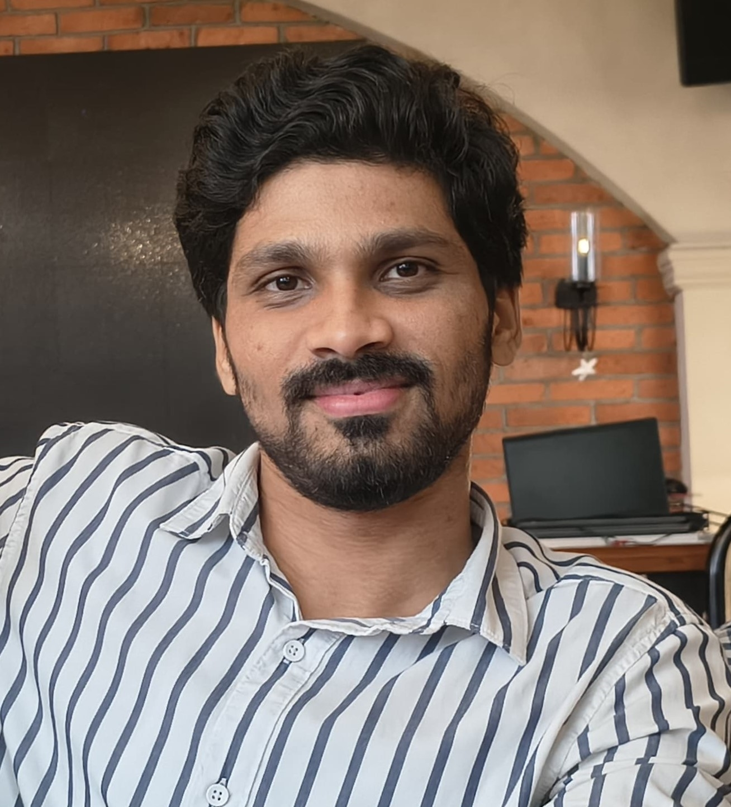
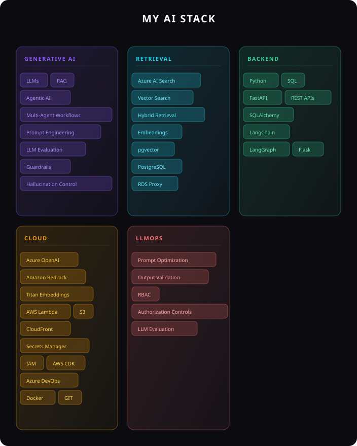
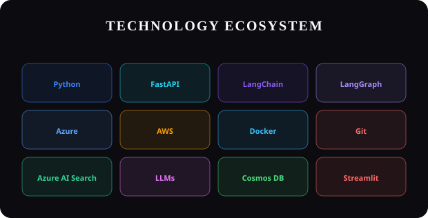
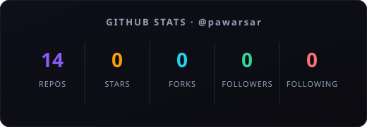

<!-- Replace with your actual photo once you add assets/profile/profile.jpg -->

<h1 style="margin: 12px 0 4px;">
  Sarvesh Pawar
</h1>

  Generative AI Engineer

  Python • Azure • AWS • FastAPI • LangChain • LangGraph

  
  &nbsp;
  
  &nbsp;
  

---

## This is me 🙂

Generative AI Engineer with 3+ years of experience building production-grade LLM applications, RAG pipelines, and agentic AI solutions using Python, FastAPI, Azure and AWS. Experienced in enterprise GenAI systems, intelligent retrieval, LLM evaluation, multi-agent workflows, and scalable AI application development.

🤖 Focused on LLMs, RAG, Agentic AI, and multi-agent systems.

☁️ Building enterprise AI solutions across Azure and AWS.

⚙️ Experienced in Python, FastAPI, LangChain, LangGraph, Azure AI Search, and intelligent retrieval systems.

🌍 Working across production GenAI systems, enterprise automation, and AI application delivery.

🧠 Interested in reliable, structured, and production-ready AI systems.

---

## My AI Stack

<table>
<tr>
<th>Domain</th><th>Technologies</th>
</tr>
<tr><td><b>Generative AI</b></td><td>`LLMs` `RAG` `Agentic AI` `Multi-Agent Workflows` `Prompt Engineering` `LLM Evaluation` `Guardrails` `Hallucination Control`</td></tr>
<tr><td><b>Retrieval</b></td><td>`Azure AI Search` `Vector Search` `Hybrid Retrieval` `Embeddings` `pgvector` `PostgreSQL` `RDS Proxy`</td></tr>
<tr><td><b>Backend</b></td><td>`Python` `SQL` `FastAPI` `REST APIs` `SQLAlchemy` `LangChain` `LangGraph` `Flask`</td></tr>
<tr><td><b>Cloud</b></td><td>`Azure OpenAI` `Amazon Bedrock` `Titan Embeddings` `AWS Lambda` `S3` `CloudFront` `Secrets Manager` `IAM` `AWS CDK` `Azure DevOps` `Docker` `GIT`</td></tr>
<tr><td><b>LLMOps</b></td><td>`Prompt Optimization` `Output Validation` `RBAC` `Authorization Controls` `LLM Evaluation`</td></tr>
</table>

---

## Experience

### Advanced App. Engineer — Accenture
*Jun 2026 - Present*

#### GenAI-Powered Recommendation Platform

- Implemented an end-to-end GenAI-powered use-case recommendation solution using RAG, Amazon Bedrock, Titan Embeddings, PostgreSQL/pgvector, FastAPI and AWS Lambda, with structured LLM outputs and deterministic fallbacks.
- Designed and implemented enterprise RBAC using Amazon Cognito JWT authentication, role-based read/write permissions, hierarchical data scoping, access-request approvals and backend authorization controls.
- Developed the solution using SQLAlchemy, RDS Proxy, S3, CloudFront, Secrets Manager, IAM and AWS CDK, with Azure DevOps CI/CD for deployment and delivery.

---

### Senior Software Engineer — Capgemini
*Jan 2023 - May 2026*

#### Core Contributions

- Built and productionized an agentic RAG system using Azure AI Search for intelligent document retrieval, task planning and enhanced decision-making.
- Implemented prompt engineering, hallucination control and output validation mechanisms to improve response accuracy and reliability.
- Developed an AI-driven test case generation platform using FastAPI and Llama-based GenAI, incorporating prompt tuning and evaluation frameworks to improve output quality and consistency.
- Designed BNG scoring logic using satellite and environmental datasets and developed an agentic AI system leveraging GBIF species and vegetation data to generate region-specific ecological insights and restoration recommendations.
- Automated SAP workflows, reducing manual effort by approximately 60%.
- Developed a RAG-based virtual assistant using Flask and Azure Search.

---

## Featured Projects

### Synapse Earth
*Geospatial AI • Biodiversity • Agentic AI*

<!-- Project image: replace assets/projects/synapse-earth.png with your actual screenshot -->

BNG scoring system using satellite and environmental datasets with AI-driven ecological recommendations. Built for real-world Biodiversity Net Gain assessments combining geospatial data pipelines and agentic RAG workflows.

**Tech:** `GEE` · `Python` · `Azure AI` · `Geospatial Data` · `Agentic AI` · `LangGraph`

🔗 [Synapse Earth Repository / Demo]([REPLACE: SYNAPSE EARTH URL])

### Agentic RAG Automation
*Azure AI Foundry • Azure AI Search • Autonomous Planning*

<!-- Project image: replace assets/projects/agentic-rag.png with your actual screenshot -->

Azure AI Foundry Agent combined with Azure AI Search for intelligent document retrieval and autonomous task planning. Features structured output generation, Cosmos DB persistence, and MCP exploration.

**Tech:** `Azure AI Foundry` · `Azure AI Search` · `FastAPI` · `Cosmos DB` · `LangGraph` · `Python`

🔗 [Agentic RAG Automation Repository / Demo]([REPLACE: AGENTIC RAG URL])

### AURA FIT
*AI-Powered Fitness Tracking Platform*

<!-- Project image: replace assets/projects/aura-fit.png with your actual screenshot -->

AI-powered fitness tracking platform built with Streamlit, FastAPI, and SQLite. Features workout tracking, nutrition logging, personal insights, and AI-driven fitness recommendations.

**Tech:** `Python` · `Streamlit` · `FastAPI` · `SQLite` · `AI`

🔗 [AURA FIT Repository / Demo]([REPLACE: AURA FIT GITHUB URL])

### On-Prem GenAI
*Llama • Enterprise AI • LLMOps*

<!-- Project image: replace assets/projects/on-prem-genai.png with your actual screenshot -->

Enterprise on-premise GenAI solution using Llama3.2-3B-Instruct with 4-bit quantization for automated test-case generation. Built with strict prompt engineering and output evaluation pipelines.

**Tech:** `Llama 3.2` · `Python` · `Prompt Engineering` · `LLMOps` · `4-bit Quantization`

🔗 [On-Prem GenAI Repository / Demo]([REPLACE: ON-PREM GENAI URL])

---

## My Skills at a Glance

  

<!-- ---

## Numbers matter? ohhh yes.

  

<!-- Live contribution graph — auto-updates via ghchart.rshah.org -->
<!--  -->

<!-- 
 --> -->

---

## Certifications

🏅 **Microsoft Azure AI Fundamentals** — `AI-900` *(Microsoft)*

🏅 **Microsoft Azure AI Engineer Associate** — `AI-102` *(Microsoft)*

## Recognition

🌟 **Innovation Award** — *Capgemini*

🌟 **Rockstar Award** — *Capgemini*

---

## Education

### Bachelor of Engineering in Electronics

**Vidyalankar Institute of Technology**
*2018 – 2022*
CGPA: **8.57/10**

---

## Let's Connect

I'm always open to conversations about:

- 🤖 Generative AI & LLM Applications
- 🔍 RAG Systems & Agentic AI
- ☁️ Azure / AWS AI Engineering
- 🚀 Production AI systems and LLMOps

&nbsp;

&nbsp;

---

  Powered by 

